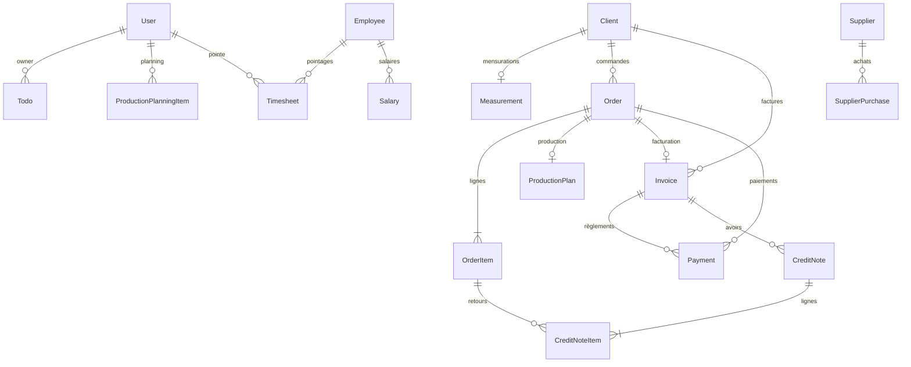

# 03 — Modèles et données

## 1. Couche de données

- **ORM** : Prisma Client `^7.8.0`, généré par `prisma generate` (exécuté dans
  `npm run build`, `package.json:7`).
- **Provider** : `postgresql` (`prisma/schema.prisma:6`).
- **Adaptateur runtime** : `PrismaPg` (driver `pg`) — `lib/prisma.ts:8`. Le
  client est un **singleton** mis en cache sur `globalThis` hors production
  (`lib/prisma.ts:12-14`).
- **Migrations** : SQL versionné dans `prisma/migrations/` (3 migrations :
  `20260510200352_init`, `20260531120000_exchange_rates_and_payment_conversion`,
  `20260531153000_add_credit_notes`).
- **Seeds** : `prisma/seed.ts` (admin Supabase + `User`), `prisma/import-data.ts`
  (import clients/fournisseurs/achats/factures depuis `prisma/seed-data.ts`).

Toutes les clés primaires sont des `String` en **UUID** (`@default(uuid())`),
sauf `ExchangeRate` dont la clé est la devise (`currency String @id`).

## 2. Diagramme des entités

> `PriceList`, `CashEntry` et `ExchangeRate` sont des entités autonomes (pas de
> relation sortante matérialisée).
> `PriceList.supplierId` est un `String?` **non relié** par une relation Prisma à
> `Supplier`.

## 3. Modèles

### Auth / Utilisateurs

**`User`** — `schema.prisma:9`
`id`, `email` (unique), `name`, `role` (`UserRole`, défaut `COMMERCIAL`),
`active` (défaut `true`), `createdAt`, `updatedAt`.
Relations : `todos`, `productionItems`, `timesheets`.
> Le seed crée le `User` Prisma avec `id = authId` Supabase (`prisma/seed.ts:35`),
> ce qui aligne l'identifiant Prisma sur celui de Supabase Auth.

**`UserRole`** (enum) : `ADMIN`, `COMMERCIAL`, `PRODUCTION`, `COMPTABLE`, `RH`.

### Clients

**`Client`** — `schema.prisma:31`
`type` (`ClientType`, défaut `BRAND`), `company?`, `firstName?`, `lastName?`,
`email?`, `phone?`, `address?`, `city?`, `country` (défaut `MA`), `ice?`,
`tvaNumber?`, `notes?`, `active` (défaut `true`), timestamps.
Index : `company`, `lastName`. Relations : `measurements` (1-1),
`orders` (1-N), `invoices` (1-N).

**`ClientType`** (enum) : `BRAND`, `B2B`, `INDIVIDUAL`, `STUDIO`.

**`Measurement`** — `schema.prisma:64`
1-1 avec `Client` (`clientId` unique). Champs flottants optionnels :
`shoulder`, `chest`, `waist`, `hips`, `length`, `waistLength`, `sleeves`,
`notes?`, `updatedAt`.

### Commandes

**`Order`** — `schema.prisma:79`
`reference` (unique), `clientId`, `status` (`OrderStatus`, défaut `QUOTE`),
`orderDate` (défaut now), `deadline?`, `totalHT`/`totalTTC`
(`Decimal(12,2)`, défaut 0), `currency` (défaut `MAD`), `notes?`.
Index : `clientId`, `status`. Relations : `items` (1-N, cascade),
`production` (1-1), `invoice` (1-1), `payments` (1-N).

**`OrderStatus`** (enum) : `QUOTE`, `CONFIRMED`, `SOURCING`, `STUDY`,
`PRODUCTION`, `READY`, `DELIVERED`, `INVOICED`, `PAID`, `CANCELLED`.

**`OrderItem`** — `schema.prisma:116`
`orderId` (`onDelete: Cascade`), `designation`, tailles `sizeS/M/L/XL/TU`
(`Int`, défaut 0), `quantity`, `unitPrice`/`totalPrice` (`Decimal(10,2)`),
`notes?`. Index `orderId`. Relation : `creditNoteItems`.

**`ProductionPlan`** — `schema.prisma:240`
1-1 avec `Order` (`orderId` unique). Jalons booléens + dates : `sourcingDone`/
`sourcingDate`, `studyDone`/`studyDate`, `productionDone`/`productionDate`,
`deliveryDone`/`deliveryDate`, `notes?`. Créé lors de la confirmation de devis.

> ⚠ **À vérifier** — Aucune route API ne met à jour `ProductionPlan` : les
> jalons de production ne sont pas éditables via l'API actuelle.

**`ProductionPlanningItem`** — `schema.prisma:256`
Planning hebdomadaire par utilisateur : `userId`, `weekStart`, `dayOfWeek`
(int), `tasks`, `orderId?`. Index `(weekStart, userId)`.
> Modèle non exposé par l'API.

### Facturation

**`Invoice`** — `schema.prisma:136`
`number` (unique, format `PR-<seq>/<année>`), `clientId`, `orderId` (unique,
nullable), `issueDate` (défaut now), `dueDate?`, `totalHT` (`Decimal(12,2)`),
`tvaRate` (`Decimal(5,4)`, défaut `0.20`), `tvaAmount`, `stampDuty`
(`Decimal(8,2)`, défaut 0), `totalTTC`, `status` (`InvoiceStatus`, défaut
`PENDING`), `pdfUrl?`, `accountingExported` (défaut false),
`accountingExportedAt?`, `notes?`.
Index : `clientId`, `status`. Relations : `payments`, `creditNotes`.
> `pdfUrl` est déclaré mais **jamais renseigné** dans le code ; le PDF est
> généré à la volée, non stocké.

**`InvoiceStatus`** (enum) : `DRAFT`, `PENDING`, `PARTIAL`, `PAID`, `OVERDUE`,
`CANCELLED`.

**`CreditNote`** — `schema.prisma:174`
`number` (unique, format `AV-<seq>/<année>`), `invoiceId` (`onDelete: Cascade`),
`issueDate`, `reason`, `totalHT`, `tvaRate` (défaut 0.20), `tvaAmount`,
`stampDuty`, `totalTTC`, `notes?`. Index `invoiceId`. Relation : `items`.

**`CreditNoteItem`** — `schema.prisma:195`
`creditNoteId` (cascade), `orderItemId?` (`onDelete: SetNull`), `designation`,
tailles S/M/L/XL/TU, `quantity`, `unitPrice`/`totalPrice`, `notes?`.
Index : `creditNoteId`, `orderItemId`.

### Paiements

**`Payment`** — `schema.prisma:216`
`invoiceId?`, `orderId?` (les deux relations `onDelete: SetNull`), `date`,
`amount` (`Decimal(12,2)`), `appliedAmount?` (`Decimal(12,2)`, montant
réellement imputé après conversion), `currency` (défaut `MAD`),
`exchangeRate` (`Decimal(12,6)`, défaut 1), `method` (`PaymentMethod`),
`reference?`, `notes?`, `createdAt`.
> Le champ `orderId` existe mais les paiements créés par l'API ne renseignent
> que `invoiceId` (`app/api/invoices/[id]/payments/route.ts:43`).

**`PaymentMethod`** (enum) : `CASH`, `BANK_TRANSFER`, `CHECK`, `MOBILE_PAYMENT`.

### Trésorerie

**`CashEntry`** — `schema.prisma:315`
`date`, `label`, `amount` (`Decimal(10,2)`), `type` (`CashEntryType`),
`category?`, `reference?`, `balance` (`Decimal(12,2)`, solde cumulé calculé),
`periodStart?`, `periodEnd?`, `createdAt`.

**`CashEntryType`** (enum) : `INCOME`, `EXPENSE`.

### Devises

**`ExchangeRate`** — `schema.prisma:334`
`currency` (`String @id`), `rateToMad` (`Decimal(12,6)`), `updatedAt`,
`createdAt`.
Valeurs par défaut hors base : `MAD: 1`, `EUR: 10.9`, `GBP: 12.8`, `USD: 10.1`
(`lib/exchange-rates.ts:3`). `ensureExchangeRates` insère les devises manquantes.

### Fournisseurs

**`Supplier`** — `schema.prisma:341`
`name`, `type?`, `phone?`, `email?`, `city?`, `ice?`, `active` (défaut true),
`notes?`, `createdAt`. Relation : `purchases` (1-N).

**`SupplierPurchase`** — `schema.prisma:356`
`supplierId`, `date`, `invoiceNumber?`, `description`, `amountHT`
(`Decimal(10,2)`), `tvaRate` (défaut 0.20), `tvaAmount`, `totalTTC`, `stamps`
(`Decimal(8,2)`), `paymentMethod?`, `paymentDate?`, `amountPaid`, 
`accountingExported` (défaut false), `notes?`. Index `supplierId`.

### Tâches

**`Todo`** — `schema.prisma:378`
`title`, `status` (`TodoStatus`, défaut `TODO`), `ownerId?` (`onDelete: SetNull`),
`notes?`, `dueDate?`, timestamps.

**`TodoStatus`** (enum) : `TODO`, `IN_PROGRESS`, `BLOCKED`, `DONE`.

### RH (non exposé par l'API)

**`Employee`** — `schema.prisma:269` : `name`, `role?`, `hourlyRate`
(`Decimal(8,2)`), `active`, relations `timesheets`, `salaries`.

**`Timesheet`** — `schema.prisma:281` : `employeeId`, `userId?`, `date`,
`startTime`, `endTime`, `breakDuration` (défaut 0.5), `totalHours`, `notes?`.
Index `(employeeId, date)`.

**`Salary`** — `schema.prisma:298` : `employeeId`, `weekStart`, `weekEnd`,
`normalHours`, `overtimeHours`, `baseSalary`, `bonuses`, `advances`,
`totalPaid`, `paidAt?`, `notes?`.

### Tarifs (non exposé par l'API)

**`PriceList`** — `schema.prisma:397` : `supplierId?`, `category`,
`designation`, `unitPrice` (`Decimal(10,2)`), `currency` (défaut `MAD`),
`minQty?`, `notes?`, `validFrom`, `validTo?`, `active`.

## 4. Points d'attention

- ⚠ **À vérifier** — `ProductionPlanningItem`, `Employee`, `Timesheet`,
  `Salary`, `PriceList` n'ont **aucune route API** ni page associée : modèles
  présents mais non exploités côté application.
- ⚠ **À vérifier** — `Invoice.pdfUrl` n'est jamais alimenté ; les PDF sont
  générés à la demande.
- ⚠ **À vérifier** — `Payment.orderId` et `SupplierPurchase.accountingExported`
  sont déclarés mais peu/pas renseignés par le code applicatif.
- 💡 Les montants monétaires utilisent `Decimal` ; le code convertit
  systématiquement en `Number` avant calcul et arrondit à 2 décimales.
