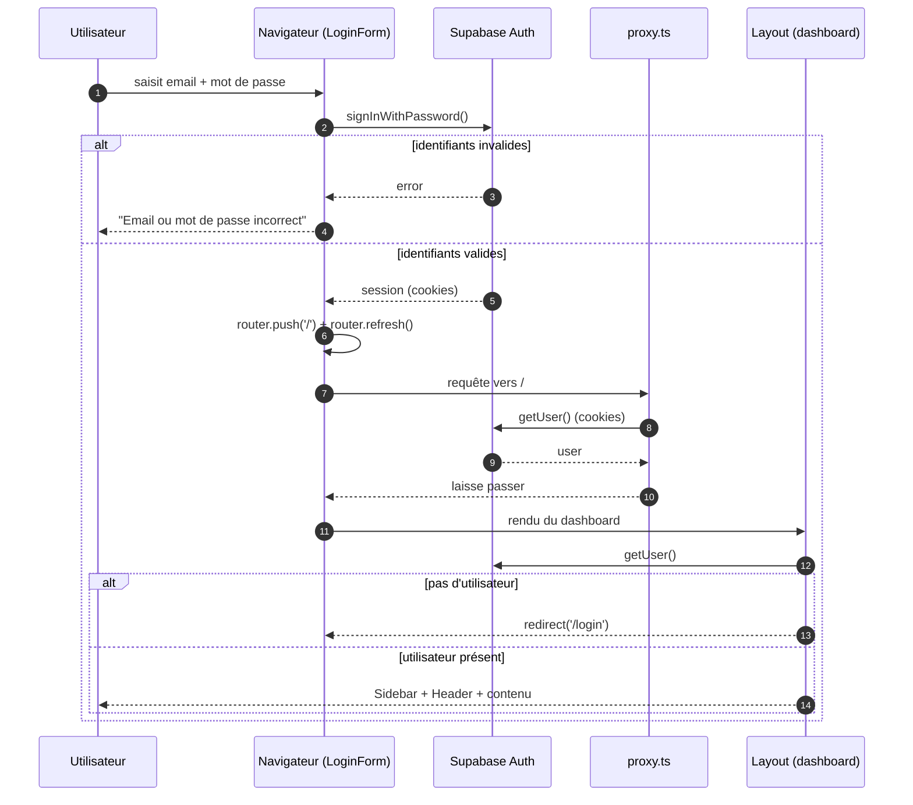
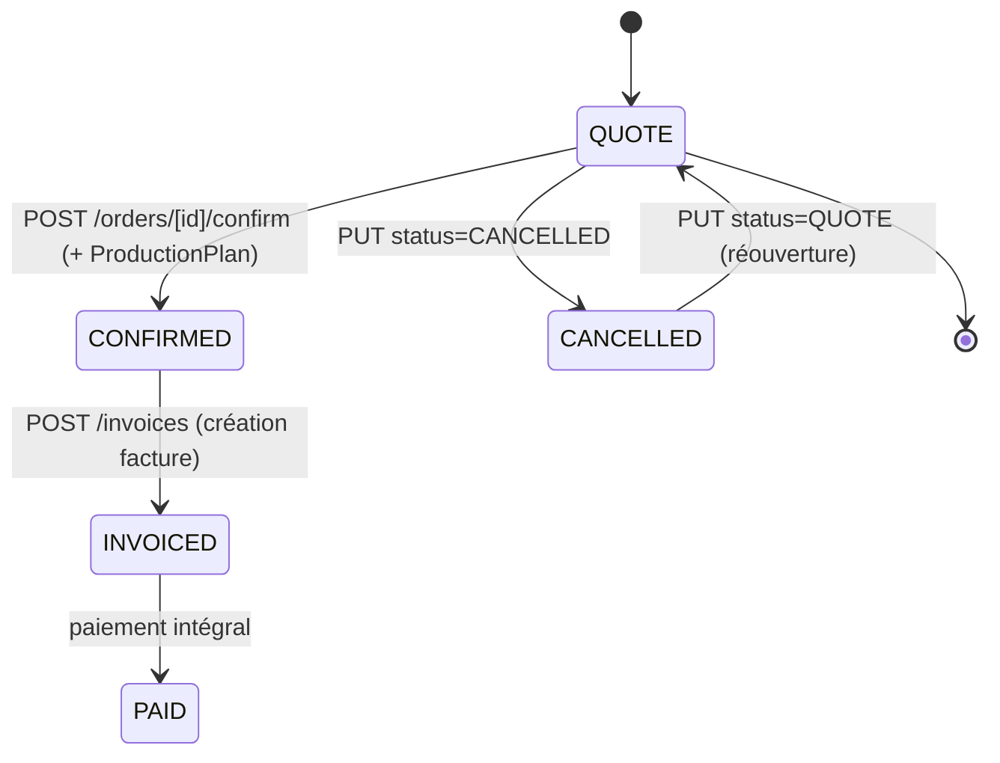
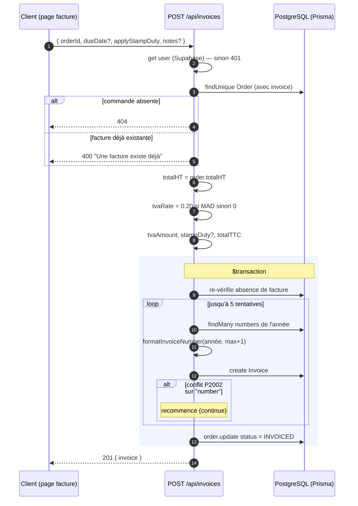
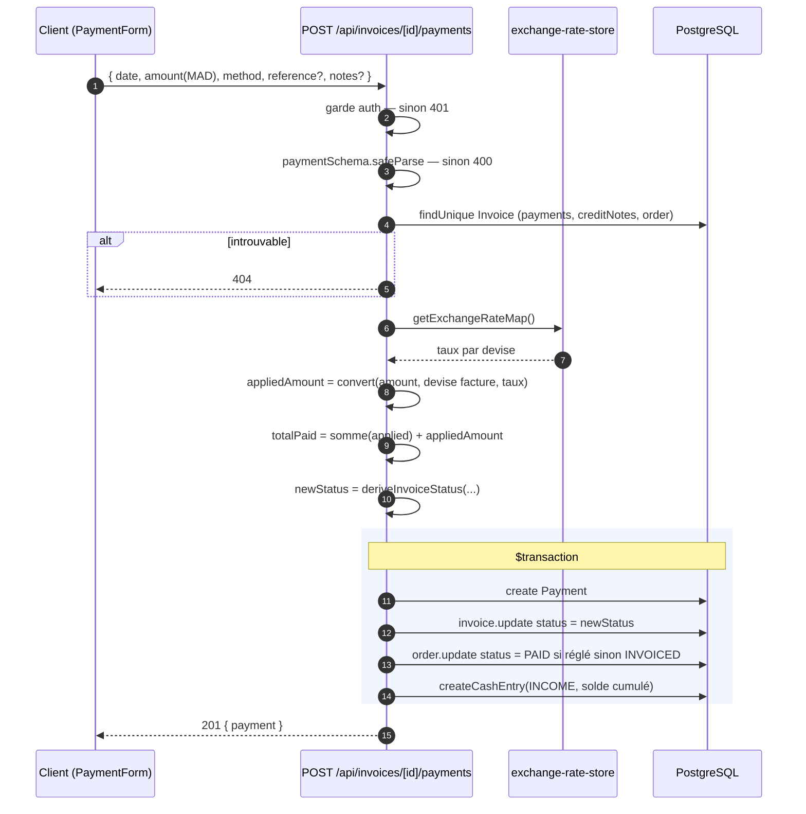
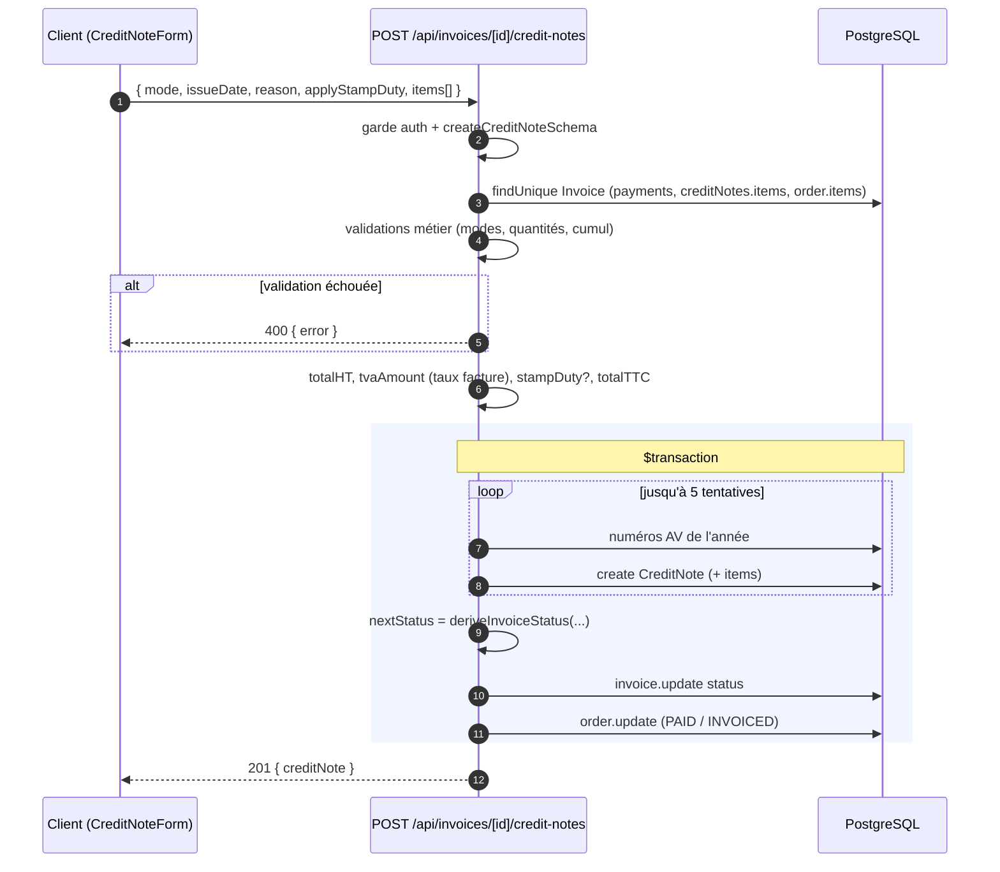
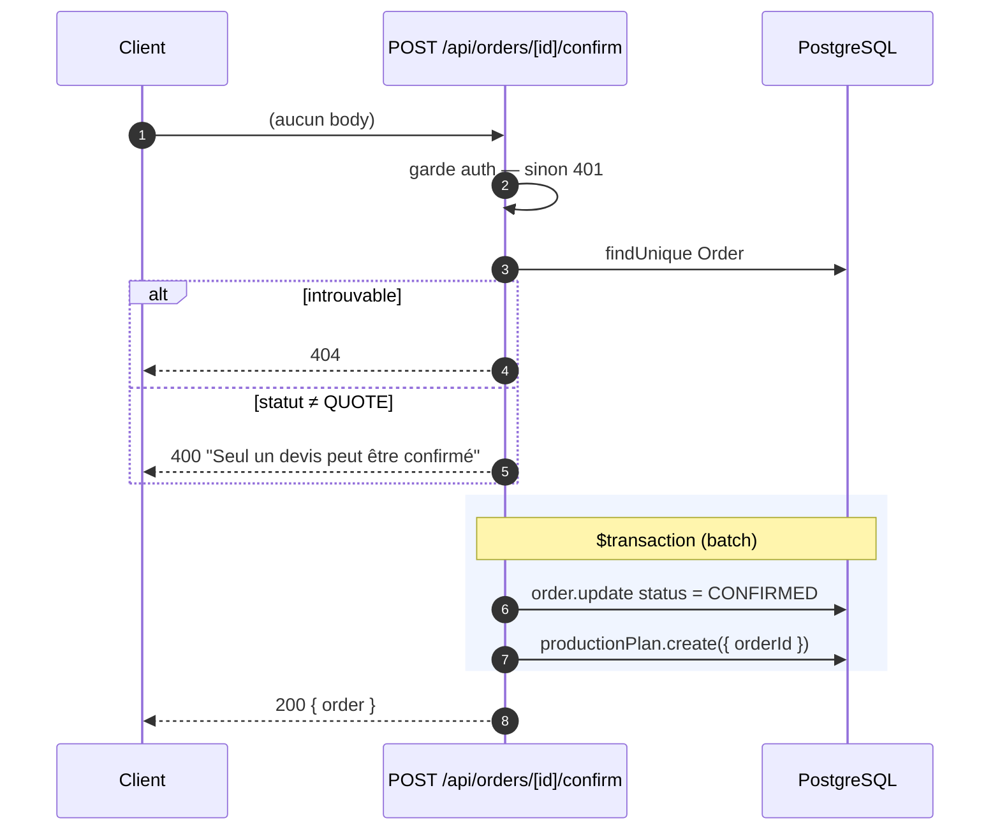

# 04 — Flux et logique métier

Cette section décrit les flux critiques **tels qu'implémentés**. Toutes les
règles proviennent de `lib/calculations/`, `lib/treasury/`, `lib/exchange-rates*`
et des Route Handlers correspondants.

## 1. Authentification

L'authentification repose entièrement sur **Supabase Auth** (email / mot de
passe). Aucun système JWT maison n'est présent.

**Trois niveaux de protection :**

1. `proxy.ts` (équivalent `middleware` Next 16) : crée un client Supabase SSR,
   appelle `getUser()`, redirige les chemins protégés vers `/login` si non
   connecté, et `/login` vers `/` si déjà connecté. **Le matcher exclut `/api`**.
2. `app/(dashboard)/layout.tsx` : `force-dynamic`, revérifie `getUser()` et
   redirige vers `/login`.
3. Chaque Route Handler : vérifie `getUser()` et renvoie `401` sinon.

Références : `app/(auth)/login/LoginForm.tsx:25`, `proxy.ts:42`,
`app/(dashboard)/layout.tsx:14`.

## 2. Cycle de vie d'une commande (devis → facture)

Statuts et transitions réellement codées :

- La confirmation crée un `ProductionPlan` et passe la commande à `CONFIRMED`
  (`app/api/orders/[id]/confirm/route.ts:17`).
- L'édition complète n'est permise que sur un devis `QUOTE`.
- Après facturation, le statut est piloté par les paiements/avoirs (via le
  statut de facture).

> ⚠ **À vérifier** — Les statuts `SOURCING`, `STUDY`, `PRODUCTION`, `READY`,
> `DELIVERED` existent et sont filtrables, mais **aucune transition logique les
> atteint** : seul un `PUT` explicite avec `status` les positionne (sans règle de
> progression ni de production associée).

## 3. Création d'une facture (numérotation & taxes)

Le numéro suit le format `PR-<séquence sur 3 chiffres>/<année>`
(`lib/calculations/invoice-number.ts`). Les taxes :

- `getVATRateForCurrency` : **0.20 si MAD, 0 sinon** (`lib/calculations/invoice.ts:3`).
- `calculateTVA = HT × taux` (arrondi 2 déc.).
- `calculateStampDuty = TTC × 0.0025`, **plafonné à 10 000** (`invoice.ts:15`).

Référence : `app/api/invoices/route.ts:74-151`.

## 4. Encaissement d'un paiement

Le paiement est **toujours saisi en MAD** (`currency: 'MAD'`), puis converti
dans la devise de la facture pour le montant imputé.

- `convertMadToInvoiceCurrency(amountMad, invoiceCurrency, rateToMad)` :
  - MAD → montant arrondi tel quel ;
  - sinon → `amountMad / rateToMad` (arrondi 2 déc.) ; `0` si taux ≤ 0
    (`lib/exchange-rates.ts:18`).
- `deriveInvoiceStatus(totalTTC, totalApplied, totalCredited, dueDate)`
  (`lib/calculations/invoice-status.ts`) :
  - `balance ≤ 0` → `PAID` ;
  - sinon si au moins un paiement/avoir → `PARTIAL` ;
  - sinon si `dueDate` dépassée → `OVERDUE` ;
  - sinon `PENDING`.

Référence : `app/api/invoices/[id]/payments/route.ts:11-78`.

## 5. Création d'un avoir (credit note)

Deux modes : `RETURN_ITEMS` (retour marchandise, contrôlé par quantités) ou
`FREE_AMOUNT` (montant libre). Le numéro suit `AV-<seq 3>/<année>`.

**Règles de contrôle (dans l'ordre) :**

1. Facture existante (`404`) et non `CANCELLED` (`400`).
2. `RETURN_ITEMS` nécessite une commande source liée (`400` sinon).
3. Par ligne retournée : calcul des quantités déjà créditées par avoir
   précédent, puis vérification que les tailles retournées et la quantité ne
   dépassent pas le facturé restant.
4. `totalHT > 0` requis.
5. Cumul `avoirs précédents + nouvel avoir ≤ totalTTC facture` (sinon `400`).
6. Génération du numéro avec 5 tentatives sur conflit `P2002`.
7. Recalcul du statut facture (et commande) dans la même transaction.

Référence : `app/api/invoices/[id]/credit-notes/route.ts:28-221`.

## 6. Confirmation de devis

Référence : `app/api/orders/[id]/confirm/route.ts:5-23`.

## 7. Conversion de devises (socle transverse)

- Devises supportées : `MAD`, `EUR`, `GBP`, `USD` (`lib/currencies.ts:1`).
- Taux stockés en base dans `ExchangeRate` (`rateToMad`) ; valeurs par défaut
  codées dans `lib/exchange-rates.ts:3`.
- `getExchangeRateMap` appelle systématiquement `ensureExchangeRates` pour
  insérer les devises manquantes (idempotent), puis lit la table et complète
  avec les valeurs par défaut. Si le délégué `exchangeRate` n'existe pas
  (modèle non généré), retourne la map par défaut.
- Les conversions servent aux paiements (`appliedAmount`) et au calcul du
  `pendingInvoicesTotal` du dashboard (conversion des soldes restants en MAD).

Références : `lib/exchange-rate-store.ts`, `lib/exchange-rates.ts`.

## 8. Trésorerie à solde cumulé

`createCashEntry` (`lib/treasury/create-cash-entry.ts`) lit la **dernière
écriture** (tri `date desc`, puis `createdAt desc`), calcule le nouveau solde
(`solde précédent ± montant`, signe selon `INCOME`/`EXPENSE`) et crée
l'écriture avec `balance`.

> ⚠ **À vérifier** — Le solde est calculé à partir de la dernière écriture
> **par date**, non par ordre d'insertion : une écriture antidatée pourrait
> produire un solde incohérent avec l'historique chronologique.

## 9. KPIs du tableau de bord

`GET /api/dashboard/kpis` exécute 8 requêtes en parallèle (`Promise.all`), puis :

- `caMonth` = somme des paiements du mois courant ;
- `pendingInvoicesTotal` = Σ du solde restant × taux de change (conversion en MAD) ;
- deadlines à moins de 7 jours pour les commandes non terminées ;
- impayés de plus de 30 jours (`PENDING`/`PARTIAL`).

Référence : `app/api/dashboard/kpis/route.ts:8-88`.

## 10. Règles tarifaires — récapitulatif

| Règle | Valeur | Source |
| --- | --- | --- |
| TVA MAD | 20 % | `getVATRateForCurrency` (`invoice.ts:4`) |
| TVA autres devises | 0 % | idem |
| Droit de timbre | 0,25 % du TTC, max 10 000 | `calculateStampDuty` (`invoice.ts:15`) |
| Numéro facture | `PR-000/AAAA` | `formatInvoiceNumber` |
| Numéro avoir | `AV-000/AAAA` | `formatCreditNoteNumber` |
| Référence commande | `DEVIS-AAAA-000` | `formatOrderReference` |
| Arrondis | 2 décimales (montants), 6 (taux) | `exchange-rates.ts` |
